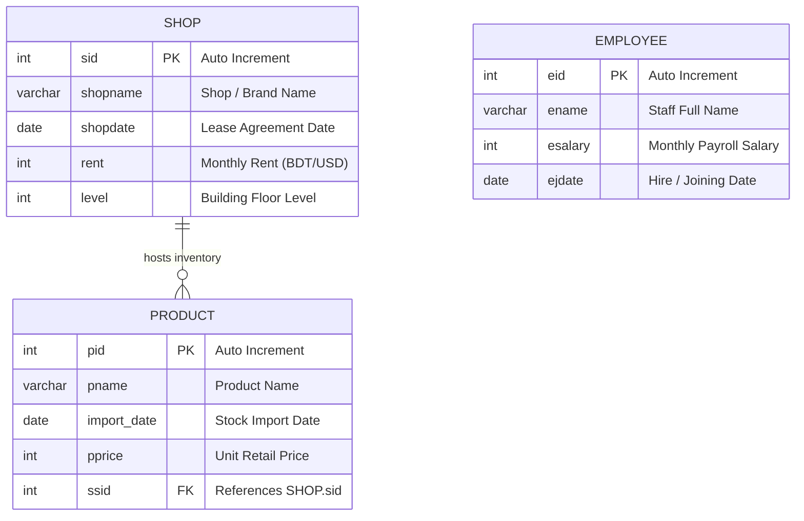

# Market Management System
### Enterprise Commercial Complex & Retail Mall ERP Solution

[](https://docs.microsoft.com/en-us/dotnet/csharp/)
[](https://dotnet.microsoft.com/)
[-0078D7.svg)](https://docs.microsoft.com/en-us/dotnet/desktop/winforms/)
[](https://www.microsoft.com/sql-server/)
[](#)

A complete **Windows Desktop Enterprise ERP Application** developed in **C# and Microsoft .NET Framework** with a **Microsoft SQL Server / LocalDB** relational backend. Designed for commercial shopping complexes, mega malls, and multi-tenant retail markets, the system centralizes commercial shop leasing, floor level allocations, monthly rent billing schedules, retail store product indexing, and employee staffing allocations.

Developed by **[Shakil Jamil Mrida](https://github.com/ShakilJamil)**.

---

## 🎯 Key Capabilities & Architectural Modules

### 1. Secure Administrative Authentication (`login.cs`)
* Guarded entry with administrative credential validation.
* Default administrative credentials:
  * **Username:** `Admin`
  * **Password:** `Password`
* Input sanitization, field validation, and state reset triggers.

### 2. Executive Navigation Hub (`menuview.cs`)
* Centralized operational dashboard providing one-click routing to:
  * **Commercial Shop Lease Management (`shopms.cs`)**
  * **Store Product Inventory (`productms.cs`)**
  * **Employee Staffing & Payroll (`Employees.cs`)**
  * Session termination and logout workflows.

### 3. Commercial Shop & Tenant Lease Management (`shopms.cs`)
* Comprehensive lifecycle tracking for commercial shopping floor tenants.
* Attributes: Shop Identifier (`sid`), Commercial Shop Name (`shopname`), Lease Agreement Date (`shopdate`), Monthly Rental Rate (`rent`), and Building Floor/Level (`level`).
* Automated rent calculation across floor levels (Ground Floor, 1st Floor, Food Court, etc.).
* Full CRUD capabilities with instant `DataGridView` data binding.

### 4. Retail Product Catalog per Tenant (`productms.cs`)
* Relational store inventory tracking linking products directly to their parent commercial shop via relational foreign key bindings.
* Attributes: Product ID (`pid`), Product Name (`pname`), Import Date (`import_date`), Unit Retail Price (`pprice`), and Parent Shop Identifier (`ssid` &rarr; `Shoptb.sid`).
* Real-time dynamic `ComboBox` data binding populated directly from registered active shops.

### 5. Employee Staffing & Payroll Operations (`Employees.cs`)
* Human resources and shift allocation across the commercial mall complex.
* Attributes: Employee ID (`eid`), Full Name (`ename`), Monthly Compensation/Salary (`esalary`), and Hire/Joining Date (`ejdate`).
* Complete CRUD records with auditable database updates.

### 6. Robust ADO.NET Data Access Layer (`Funtions.cs`)
* Encapsulated relational database access using `System.Data.SqlClient`.
* Methods:
  * `GetData(string Query)`: Executes SQL queries via `SqlDataAdapter` and returns populated `DataTable` instances for seamless UI data binding.
  * `SetData(string Query)`: Manages open/closed connection states and executes `SqlCommand.ExecuteNonQuery()` for transactional inserts, updates, and deletes.

---

## 🏗️ Relational Database Architecture



---

## 📂 Repository Structure

```
marketmngt/
├── Employees.cs                 # Employee management logic & event handlers
├── Employees.Designer.cs        # WinForms visual design code
├── Employees.resx               # Localized resources
├── Funtions.cs                  # ADO.NET Database helper & SQL execution
├── login.cs                     # Authentication form
├── login.Designer.cs            # Login form UI components
├── menuview.cs                  # Executive main dashboard
├── menuview.Designer.cs         # Navigation dashboard UI
├── productms.cs                 # Tenant product catalog management
├── productms.Designer.cs        # Product catalog UI
├── shopms.cs                    # Commercial shop lease & floor management
├── shopms.Designer.cs           # Shop lease UI
├── market management.sln        # Visual Studio Solution specification
├── market management.csproj     # C# Project dependencies & build config
└── README.md                    # Project documentation
```

---

## 🚀 Setup & Execution Guide

### Prerequisites
* **Windows OS (Windows 10 / 11)**
* **Visual Studio 2019 / 2022** (with *.NET desktop development* workload)
* **SQL Server LocalDB / SQL Server Express**

### 1. Database Configuration
The application connects via `(LocalDB)\MSSQLLocalDB` defined in `Funtions.cs`:
```csharp
ConStr = @"Data Source=(LocalDB)\MSSQLLocalDB;AttachDbFilename=""C:\...\EMPDB.mdf"";Integrated Security=True;Connect Timeout=30";
```

To create the required SQL tables on your database server:
```sql
CREATE DATABASE EMPDB;
USE EMPDB;

CREATE TABLE emptb (
    eid INT IDENTITY(1,1) PRIMARY KEY,
    ename VARCHAR(100) NOT NULL,
    esalary INT NOT NULL,
    ejdate VARCHAR(50) NOT NULL
);

CREATE TABLE Shoptb (
    sid INT IDENTITY(1,1) PRIMARY KEY,
    shopname VARCHAR(100) NOT NULL,
    shopdate VARCHAR(50) NOT NULL,
    rent INT NOT NULL,
    level INT NOT NULL
);

CREATE TABLE producrtb (
    pid INT IDENTITY(1,1) PRIMARY KEY,
    pname VARCHAR(100) NOT NULL,
    import_date VARCHAR(50) NOT NULL,
    pprice INT NOT NULL,
    ssid INT NOT NULL,
    CONSTRAINT FK_Shop FOREIGN KEY (ssid) REFERENCES Shoptb(sid) ON DELETE CASCADE
);
```

### 2. Open & Run with Visual Studio
1. Double-click `market management.sln` to open the solution in Visual Studio.
2. Verify target framework is set to **.NET Framework 4.7.2+**.
3. Press **`F5`** or click **Start** to compile and launch the Windows desktop application.
4. Sign in with:
   * **Username:** `Admin`
   * **Password:** `Password`

---

## 👨‍💻 Author

**Shakil Jamil Mrida**
* **Degree:** B.Sc. in Computer Science & Engineering, American International University-Bangladesh (AIUB)
* **Honors:** 6-time Dean's Award Recipient
* **Portfolio:** [https://shakiljamil.github.io/](https://shakiljamil.github.io/)
* **LinkedIn:** [https://www.linkedin.com/in/Shakil%20Jamil%20Mrida](https://www.linkedin.com/in/Shakil%20Jamil%20Mrida)
* **Email:** [mafialhasan@gmail.com](mailto:mafialhasan@gmail.com)
